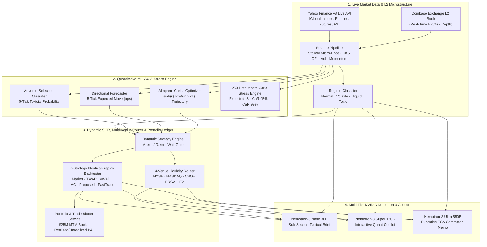

# FastTrade — Institutional Smart Order Routing, Live Microstructure & Quantitative Execution Terminal

**Created & Architected by:** Ritesh Kochar ([`@ensuredesign`](https://github.com/ensuredesign) · `ensure01@gmail.com`)  
**Live Institutional Terminal:** [https://fasttrade-smoky.vercel.app](https://fasttrade-smoky.vercel.app)  
**Repository:** [https://github.com/ensuredesign/FastTrade](https://github.com/ensuredesign/FastTrade)

---

## Executive Overview

**FastTrade** is an institutional-grade **Execution Management System (EMS), Live Cross-Asset Market Monitor, Mark-to-Market Portfolio & Trade Blotter, and Quantitative Order-Book Microstructure Terminal** engineered by **Ritesh Kochar**.

When institutional execution desks trade large parent orders (`1,000` to `50,000+` units across US Equities, Index Futures, or Digital Assets), static execution schedules such as **TWAP** and **VWAP** suffer from two compounding sources of execution alpha decay:
1. **Adverse Selection (Toxic Flow):** Resting passive maker orders get systematically run over by informed takers milliseconds before an adverse price jump.
2. **Rigid Trajectory Slicing:** Static schedules ignore real-time Level-2 (L2) order book depth collapse, Order Flow Imbalance (OFI), and fragmented multi-venue fee/rebate dynamics.

**FastTrade** solves this by coupling:
- **Live Cross-Asset Market Data (`services/market_data_service.py`):** Real-time quotes, 5-minute intraday OHLCV & cumulative session VWAP series, realized volatility, and live L2 order book depth from **Yahoo Finance v8** and **Coinbase Exchange L2** across Global Indices (`SPX`, `NDX`, `DJI`, `VIX`, `US10Y`, `BTC-USD`, `NVDA`, `EUR/USD`) and an 8-instrument institutional execution universe (`NVDA`, `BTC-USD`, `SPY`, `AAPL`, `MSFT`, `ETH-USD`, `ES-FUT`, `NQ-FUT`).
- **Real-Time Mark-to-Market Portfolio & Trade Blotter (`services/portfolio_service.py`):** Persistent $25.0M multi-asset institutional position book with FIFO/average-cost realized & unrealized P&L attribution, live mark-to-market valuation, cumulative implementation shortfall alpha savings ledger, and CSV-exportable trade blotter.
- **L2 Order-Book Microstructure Engine (`features/`):** Real-time **Stoikov Volume-Weighted Micro-Price** and **Cont–Kukanov–Stoikov Order Flow Imbalance (OFI)** across a 5-level limit order book.
- **Closed-Form Almgren–Chriss Trajectory Optimizer (`execution/almgren_chriss.py`):** Hyperbolic $\sinh(\kappa(T-t))/\sinh(\kappa T)$ optimal parent-order slicing balancing permanent impact ($\gamma$), temporary impact ($\eta$), volatility ($\sigma$), and trader risk aversion ($\lambda$).
- **Pre-Trade Monte Carlo Cost-at-Risk Stress Engine (`POST /api/v1/dashboard/pretrade-stress`):** 250-path vectorized jump-diffusion & Hawkes toxicity simulation computing Expected Implementation Shortfall, $\text{CaR}_{95\%}$, $\text{CaR}_{99\%}$, CRO guardrail verification, and 1-click closed-form parameter calibration.
- **4-Venue Fragmented Liquidity Router (`execution/venue_router.py`):** Dynamic allocation across `NYSE`, `NASDAQ`, `CBOE EDGX`, and `IEX` (dark midpoint speed-bump protection during high toxicity).
- **Multi-Tier NVIDIA Nemotron-3 Quant Copilot (`services/nebius_ai.py`):** Complexity-routed inference across **Nemotron-3 Nano 30B**, **Super 120B**, and **Ultra 550B** for real-time tactical briefs, interactive microstructure Q&A, and Investment Committee Post-Trade TCA Audit Memos.

---

## System Architecture



---

## 8-Tab Institutional Workspace

1. **`Live Market Overview`** — Live Yahoo Finance global indices ticker bar (`SPX`, `NDX`, `DJI`, `VIX`, `US10Y`, `BTC-USD`, `NVDA`, `EUR/USD`), live 5-minute intraday price vs. cumulative session VWAP chart, Cont–Kukanov–Stoikov OFI & spread dynamics chart, and 8-asset liquidity screener with 1-click EMS loading and order booking.
2. **`Portfolio & Trade Book`** — Real-time mark-to-market institutional position holdings ($25.0M desk capital), realized & unrealized P&L attribution, direct live SOR order execution ticket, cumulative TCA alpha savings ledger, and CSV-exportable trade blotter.
3. **`EMS Execution & L2 Book`** — Parent order ticket, interactive Almgren–Chriss & SOR parameter sliders ($\lambda$, toxicity withdrawal gate, urgency gate, slice count $N$), tick-by-tick replay scrubber, 5-level L2 Order Book with Stoikov micro-price, and Almgren–Chriss schedule.
4. **`Multi-Venue SOR & TCA`** — 4-venue fragmented liquidity router (`NYSE`, `NASDAQ`, `CBOE EDGX`, `IEX`) and 6-strategy Implementation Shortfall benchmark table & cost decomposition charts.
5. **`Pre-Trade Monte Carlo`** — 250-path stochastic jump-diffusion Cost-at-Risk ($\text{CaR}_{95\%}$, $\text{CaR}_{99\%}$) stress tester, CRO guardrail check, and 1-click closed-form parameter optimizer.
6. **`Quant Signals & LOB`** — ML adverse-selection toxicity timeline, directional 5-tick GRU forecast chart, and 6-panel L2 order-book microstructure telemetry.
7. **`AI Quant Copilot`** — Multi-tier NVIDIA Nemotron-3 tactical execution brief, interactive quant copilot, and exportable Executive Post-Trade TCA Audit Memo.
8. **`CRO Risk Governance`** — Chief Risk Officer global risk guardrails, institutional seat directory, and compliance audit dispatch.

---

## Quantitative Foundations

### 1. Stoikov Volume-Weighted Micro-Price
$$P_{\text{micro}} = \frac{P_{\text{bid},1} \cdot Q_{\text{ask},1} + P_{\text{ask},1} \cdot Q_{\text{bid},1}}{Q_{\text{bid},1} + Q_{\text{ask},1}}$$

### 2. Cont–Kukanov–Stoikov Order Flow Imbalance (OFI)
$$\text{OFI}_t = e_t^B - e_t^A, \quad \text{where } e_t^B = \mathbb{I}_{\{P_{B,t} \ge P_{B,t-1}\}} Q_{B,t} - \mathbb{I}_{\{P_{B,t} \le P_{B,t-1}\}} Q_{B,t-1}$$

### 3. Closed-Form Almgren–Chriss Optimal Trajectory
$$\kappa = \sqrt{\frac{\lambda \sigma^2}{\eta}}, \qquad x(t_j) = X_0 \frac{\sinh(\kappa (T - t_j))}{\sinh(\kappa T)}$$

---

## Quick Start

### 1. Install Dependencies
```bash
pip install -r requirements.txt
cd frontend && npm install && cd ..
```

### 2. Run Backend & Frontend
```bash
# Terminal 1: FastAPI Backend (Port 8000)
python -m uvicorn api.main:app --host 127.0.0.1 --port 8000

# Terminal 2: React + Vite Frontend (Port 5173)
cd frontend && npm run dev
```

### 3. Run Automated Test Suite
```bash
python -m pytest -q
```

---

## Author & License

- **Author:** Ritesh Kochar ([`@ensuredesign`](https://github.com/ensuredesign) · `ensure01@gmail.com`)
- **License:** MIT License — Copyright (c) 2026 Ritesh Kochar
