<div align="center">

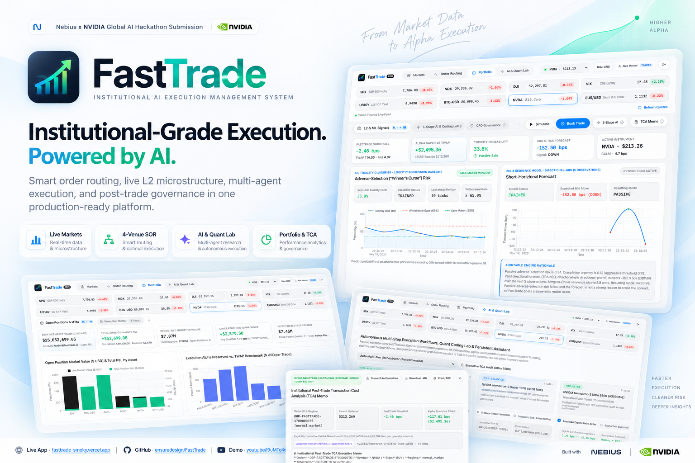

<br />

# FastTrade — Institutional AI Execution Management System (EMS)

### Smart Order Routing · Live L2 Microstructure · Multi-Agent NVIDIA Nemotron-3 Orchestration · Isolated Cloud Sandboxes · Post-Trade Governance

[](https://fasttrade-smoky.vercel.app)
[](https://youtu.be/I9uMToKesDI)
[](./docs/README.md)

[](https://tokenfactory.nebius.com)
[-76B900?style=flat-square&logo=nvidia&logoColor=white)](./docs/AGENTIC_AI_AND_SANDBOX_ARCHITECTURE.md)
[-2563EB?style=flat-square)](./docs/AGENTIC_AI_AND_SANDBOX_ARCHITECTURE.md)
[](https://smith.langchain.com/public/92ecc909-fef0-4324-baf3-3a3fcb463a25/r)
[](./docs/API_AND_OPERATIONS_GUIDE.md)
[](./docs/SYSTEM_ARCHITECTURE_AND_FLOWCHARTS.md)
[](./LICENSE)

**[Live Production App](https://fasttrade-smoky.vercel.app)** · **[2-Minute Demo Video](https://youtu.be/I9uMToKesDI)** · **[System Flowcharts](./docs/SYSTEM_ARCHITECTURE_AND_FLOWCHARTS.md)** · **[Quant Math Spec](./docs/QUANTITATIVE_MATHEMATICAL_SPECIFICATION.md)** · **[Agent & Sandbox Spec](./docs/AGENTIC_AI_AND_SANDBOX_ARCHITECTURE.md)** · **[REST API Guide](./docs/API_AND_OPERATIONS_GUIDE.md)** · **[Quick Start](#quick-start)**

</div>

---

## Executive Overview

**FastTrade** is a production-grade **Institutional Execution Management System (EMS), Real-Time Cross-Asset Market Monitor, `$25.0M` Mark-to-Market Portfolio & Blotter, and Autonomous Multi-Agent Quantitative Execution Platform** created and architected by **Ritesh Kochar** ([`@ensuredesign`](https://github.com/ensuredesign)).

When institutional desks execute large parent block orders (`1,000` to `50,000+` units, or `$1M–$100M+` notional) across US Equities, Index Futures, or Digital Assets, naive execution algorithms (`TWAP`, `VWAP`, static `Passive Maker`, or immediate `Market Sweep`) lose **15 to 45 bps of Implementation Shortfall** to two compounding structural forces:

1. **Adverse Selection ("Winner's Curse" / Toxic Order Flow):** Informed low-latency arbitrageurs sweep resting passive limit orders milliseconds before an unfavorable price jump—turning apparent maker rebates into steep post-fill mark-out losses.
2. **Static Trajectory Blindness:** Fixed-clock schedules slice inventory uniformly while ignoring real-time Level-2 (L2) queue depletion, Order Flow Imbalance (OFI), volatility spikes, and fragmented multi-venue fee/rebate dynamics.

**FastTrade** solves this end-to-end by uniting **closed-form microstructure & optimal-control mathematics** with a **3-tier NVIDIA Nemotron-3 agentic workflow**, **isolated Nebius ConTree Cloud Sandboxes**, **live cross-asset feeds**, and **publicly auditable LangSmith traces**.

---

## Official 2-Minute Product Walkthrough Video

<div align="center">
  <a href="https://youtu.be/I9uMToKesDI">
    
  </a>
  <p>
    <strong>Click above to watch on YouTube: <a href="https://youtu.be/I9uMToKesDI">https://youtu.be/I9uMToKesDI</a></strong>
  </p>
</div>

| Timestamp | Walkthrough Chapter | Key Highlights Demonstrated |
| :---: | :--- | :--- |
| `0:00 – 0:20` | **The Problem** | Adverse selection ("Winner's Curse"), L2 liquidity evaporation, and 15–45 bps alpha decay on block trades. |
| `0:20 – 0:38` | **Mathematical Core** | Closed-form Almgren–Chriss hyperbolic trajectories, Stoikov micro-price, and Cont–Kukanov–Stoikov OFI. |
| `0:38 – 0:58` | **AI & Cloud Architecture** | Nebius Token Factory routing across NVIDIA Nemotron-3 `Nano 30B`, `Super 120B`, and `Ultra 550B` + ConTree VMs. |
| `0:58 – 1:22` | **Live EMS & 4-Venue SOR** | Live L2 order book ladder, interactive tuning sliders, and fragmented routing across `NYSE`, `NASDAQ`, `CBOE EDGX`, and `IEX`. |
| `1:22 – 1:45` | **5-Stage Agent & `$25M` Blotter** | Autonomous ConTree VM policy testing (`4/4 PASS`), 500-path Monte Carlo CaR sign-off, live blotter booking, and LangSmith trace sharing. |
| `1:45 – 2:00` | **Measurable Institutional Impact** | `+4.0 to +28.5 bps` Implementation Shortfall savings, 100% completion, and exportable CRO TCA governance memos. |

---

## Preserving Alpha in Every Institutional Block Trade

<p align="center">
  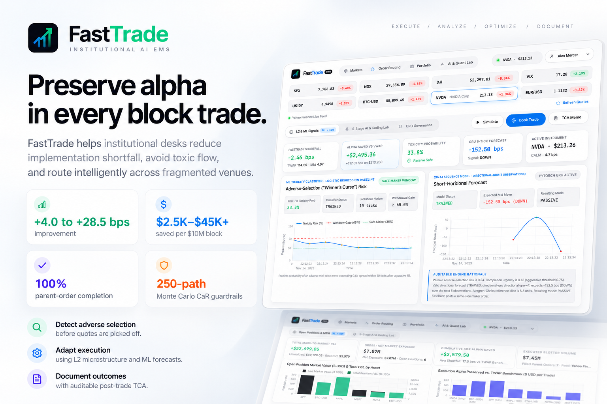
</p>

| Institutional Metric | FastTrade Benchmark Performance | Verification Mechanism |
| :--- | :--- | :--- |
| **Implementation Shortfall Alpha** | **`+4.0 to +28.5 bps` improvement** vs. TWAP / VWAP | Identical-seed 6-strategy replay backtester (`backtest/backtester.py`) |
| **Dollar Capital Preserved** | **`$2,500 – $45,000+` saved** per `$10M` parent block | Real-time TCA attribution ledger (`services/portfolio_service.py`) |
| **Parent-Order Completion** | **`100%` deterministic completion** within horizon $T$ | Urgency override gate + Almgren–Chriss terminal boundary $x(T)=0$ |
| **Pre-Trade Tail-Risk Protection** | **`250 / 500-path` Monte Carlo $\text{CaR}_{95\%/\text{99\%}}$** | Stochastic jump-diffusion + Hawkes toxicity stress tester |
| **Autonomous Code Verification** | **`4/4` deterministic L2 unit assertions** before staging | Isolated `python:3.12-slim` Nebius ConTree Cloud Micro-VMs |

---

## End-to-End 9-Step Institutional Workflow

<p align="center">
  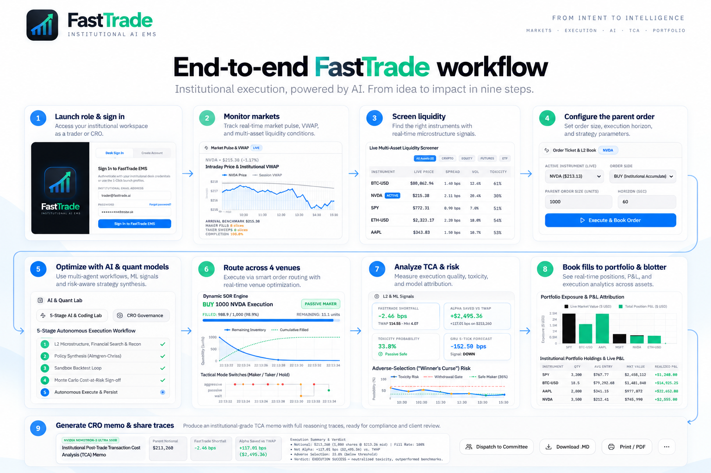
</p>

FastTrade guides institutional traders and Chief Risk Officers (CROs) from market reconnaissance to compliance-ready post-trade attribution in nine cohesive steps:

```mermaid
flowchart LR
    S1["1. Role Sign-In (Trader / CRO)"] --> S2["2. Monitor Live Markets & VWAP"]
    S2 --> S3["3. Screen 8-Asset Liquidity & OFI"]
    S3 --> S4["4. Configure Parent Block Order"]
    S4 --> S5["5. Optimize via 5-Stage AI & Quant Lab"]
    S5 --> S6["6. Route Across 4 Venues (NYSE/NASDAQ/EDGX/IEX)"]
    S6 --> S7["7. Analyze 6-Strategy TCA & Toxicity"]
    S7 --> S8["8. Commit Fill to $25M MTM Blotter"]
    S8 --> S9["9. Generate Ultra 550B CRO Memo & LangSmith Trace"]
```

---

## Platform Capabilities & Visual Tour

### 1. Real-Time Cross-Asset Markets & Liquidity Intelligence

<p align="center">
  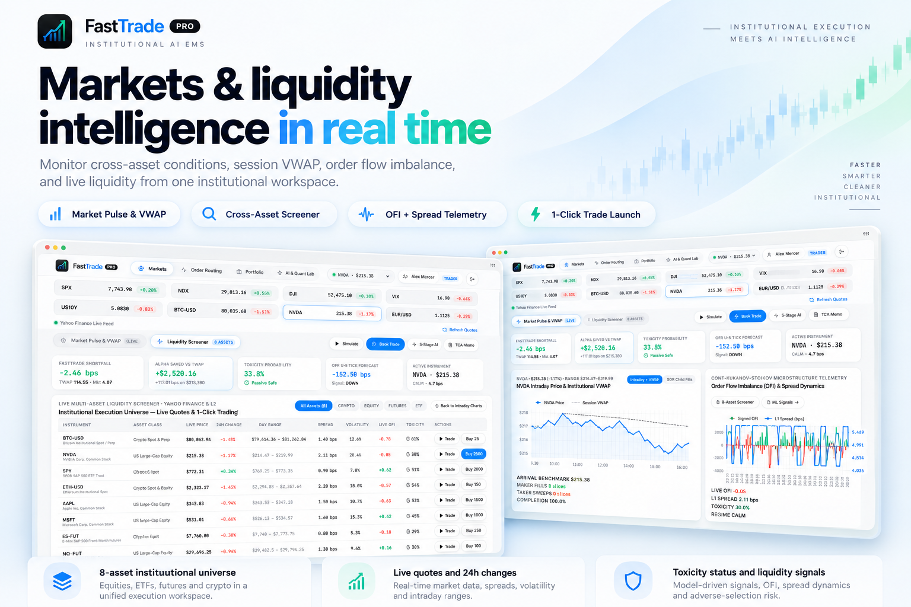
</p>

- **Concurrent Live Market Data (`services/market_data_service.py`):** Streams real-time quotes, 24h returns, intraday high/low ranges, annualized realized volatility ($\sigma$), and 5-minute intraday price vs. cumulative session VWAP curves from **Yahoo Finance v8** and **Coinbase Exchange L2**.
- **Global Macro Ribbon + 8-Asset Execution Universe:** Monitors `SPX`, `NDX`, `DJI`, `VIX`, `US10Y`, `BTC-USD`, `NVDA`, and `EUR/USD` alongside 1-click tradable instruments (`NVDA`, `BTC-USD`, `SPY`, `AAPL`, `MSFT`, `ETH-USD`, `ES-FUT`, `NQ-FUT`).
- **Live Microstructure Telemetry:** Real-time Cont–Kukanov–Stoikov signed OFI bars, L1 quoted spread dynamics, and model-driven toxicity badges.

---

### 2. Fragmented 4-Venue Smart Order Routing & 5-Level L2 Book

<p align="center">
  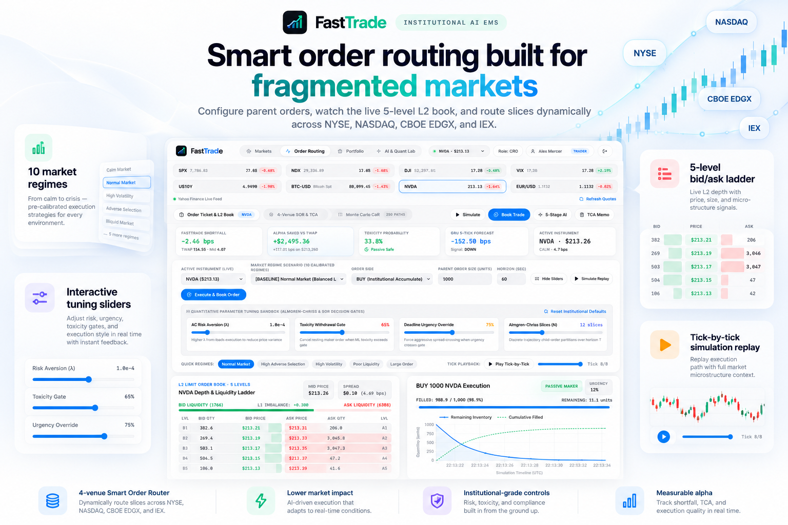
</p>

- **Dynamic 4-Venue Liquidity Router (`execution/venue_router.py`):** Routes child slices across **`NYSE`** (deep primary lit book), **`NASDAQ`** (high-speed electronic taker sweeps), **`CBOE EDGX`** (maker-rebate capture `-2.5 bps`), and **`IEX`** (350µs coiled-fiber speed-bump dark midpoint protection during toxic bursts).
- **10 Calibrated Market Regimes & Interactive Sliders:** Stress-test execution from *Calm / Normal Market* to *High Adverse Selection*, *Flash Volatility*, *Illiquid Book*, and *Institutional Block* while tuning Risk Aversion ($\lambda$), Toxicity Withdrawal Gate, Urgency Override, and Slice Count ($N$) with tick-by-tick replay scrubbing.

---

### 3. Quantitative Microstructure & Hybrid ML Engine

<p align="center">
  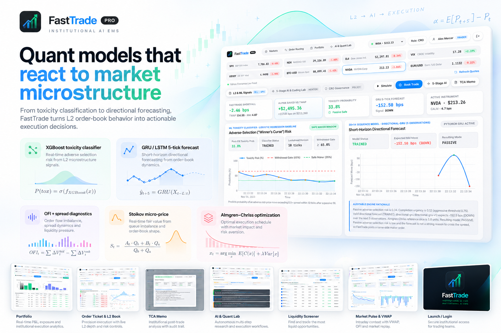
</p>

FastTrade enforces strict separation between **toxicity protection**, **short-horizon drift forecasting**, and **optimal inventory control** (full derivations in [`docs/QUANTITATIVE_MATHEMATICAL_SPECIFICATION.md`](./docs/QUANTITATIVE_MATHEMATICAL_SPECIFICATION.md)):

1. **Stoikov Volume-Weighted Micro-Price:**
   $$P_{\text{micro},t} = \frac{P_{\text{bid},1,t} \cdot Q_{\text{ask},1,t} + P_{\text{ask},1,t} \cdot Q_{\text{bid},1,t}}{Q_{\text{bid},1,t} + Q_{\text{ask},1,t}}$$
2. **Cont–Kukanov–Stoikov Order Flow Imbalance (OFI):**
   $$\text{OFI}_t = e_t^B - e_t^A, \quad e_t^B = \mathbb{I}_{\{P_{B,t} \ge P_{B,t-1}\}} Q_{B,t} - \mathbb{I}_{\{P_{B,t} \le P_{B,t-1}\}} Q_{B,t-1}$$
3. **Closed-Form Almgren–Chriss Hyperbolic Trajectory (`execution/almgren_chriss.py`):**
   $$\kappa = \sqrt{\frac{\lambda \sigma^2}{\eta}}, \qquad x(t_j) = X_0 \frac{\sinh\big(\kappa (T - t_j)\big)}{\sinh(\kappa T)}$$
4. **Calibrated 28-Feature XGBoost Toxicity Classifier (`models/predictor.py`):** Predicts 10-tick post-fill adverse selection probability $P(\text{tox}) \in [0, 1]$ to withdraw vulnerable passive maker orders before informed sweeps strike.
5. **PyTorch Sequence-to-Vector GRU Forecaster (`models/local_forecaster.py`):** Consumes a strictly validated `(20, 14)` canonical microstructure window (`data/contracts.py`) to forecast 5-tick mid-price drift in basis points.

---

### 4. Multi-Agent Quant Copilot, ConTree Cloud Sandboxes & LangSmith Auditability

<p align="center">
  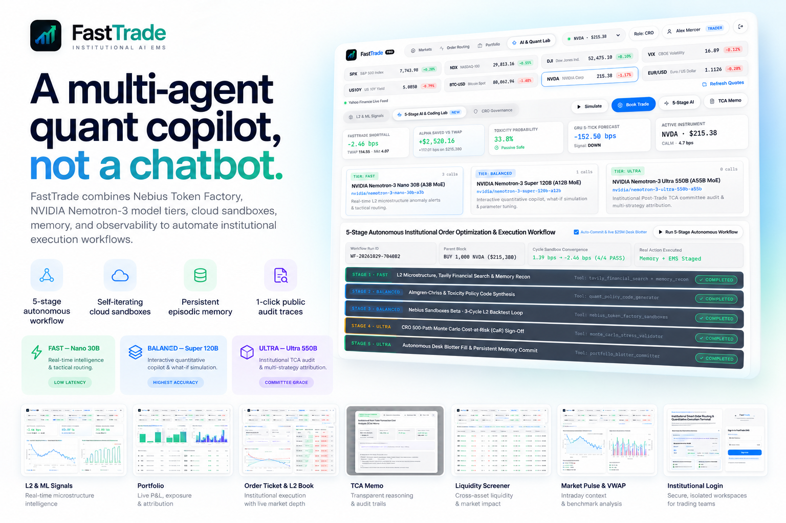
</p>

Rather than a conversational wrapper, FastTrade orchestrates **three NVIDIA Nemotron-3 Mixture-of-Experts (MoE) model tiers on Nebius Token Factory** inside a verifiable execution loop (detailed in [`docs/AGENTIC_AI_AND_SANDBOX_ARCHITECTURE.md`](./docs/AGENTIC_AI_AND_SANDBOX_ARCHITECTURE.md)):

- **FAST Tier (`nvidia/NVIDIA-Nemotron-3-Nano-30B-A3B`):** Sub-second L2 anomaly reconnaissance, **Tavily Finance** live news catalyst synthesis, and episodic memory lookup.
- **BALANCED Tier (`nvidia/nemotron-3-super-120b-a12b`):** Powers the **Self-Iterating Quant Strategy Coding Agent**, refactoring Python policies (`v1.0 -> v2.0 -> v3.0`) across **isolated Nebius ConTree Cloud Micro-VMs (`contree-sdk`, `python:3.12-slim`)** with AST safety gates and copy-on-write `promoted_image_uuid` snapshots until `4/4` L2 unit assertions pass.
- **ULTRA Tier (`nvidia/Nemotron-3-Ultra-550b-a55b`):** Performs 500-path Monte Carlo $\text{CaR}_{99\%}$ Chief Risk Officer sign-off and authors Investment Committee Post-Trade TCA Memos.
- **1-Click Public LangSmith Judge Audit Links (`smith.langchain.com`):**
  - Verified 5-Stage Autonomous Workflow Trace: [`smith.langchain.com/public/92ecc909-fef0-4324-baf3-3a3fcb463a25/r`](https://smith.langchain.com/public/92ecc909-fef0-4324-baf3-3a3fcb463a25/r)
  - Verified ConTree Parallel Sandbox Trace: [`smith.langchain.com/public/b12df4b0-9e09-4fa6-9830-c0cfa05dcbdd/r`](https://smith.langchain.com/public/b12df4b0-9e09-4fa6-9830-c0cfa05dcbdd/r)

---

### 5. `$25.0M` Isolated Desk Portfolio, MTM P&L & Immutable Execution Audit Trail

<p align="center">
  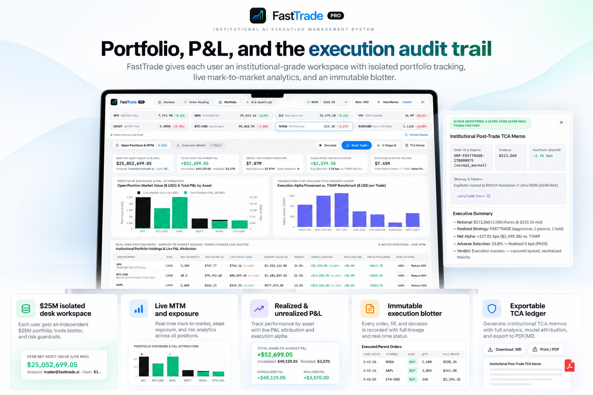
</p>

- **Per-User Isolated `$25.0M` Institutional Book (`services/portfolio_service.py`):** Tracks live mark-to-market NAV, gross/net exposure, average-cost realized & unrealized P&L by position, and cumulative SOR dollar alpha saved vs. TWAP.
- **Immutable Trade Blotter & Committee Export:** Every manual or autonomous fill records arrival price, average execution price, shortfall (bps), venue allocation, and regime lineage—exportable via **1-click CSV**, **Markdown (`.md`)**, **Print/PDF**, or **Resend Committee Email Dispatch**.

---

## System Architecture & Execution Flowcharts

### Layered Full-Stack System Architecture

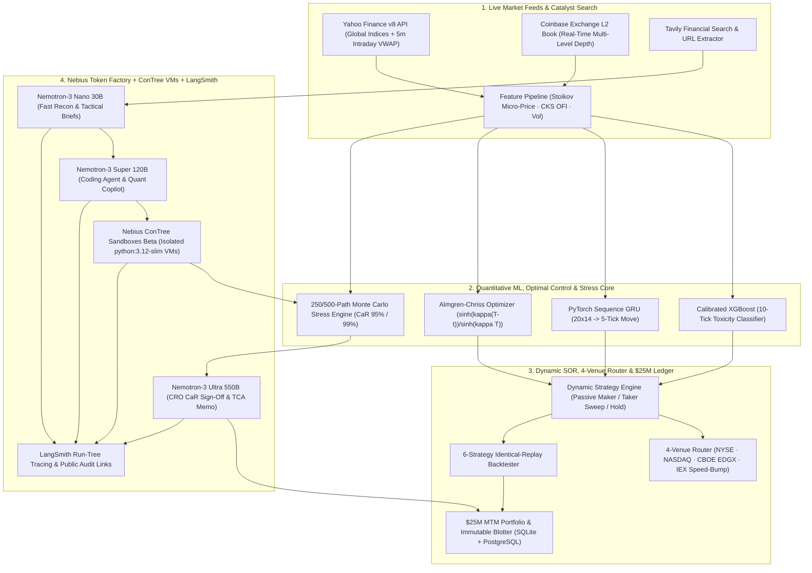

### 5-Stage Autonomous Agent Execution Sequence

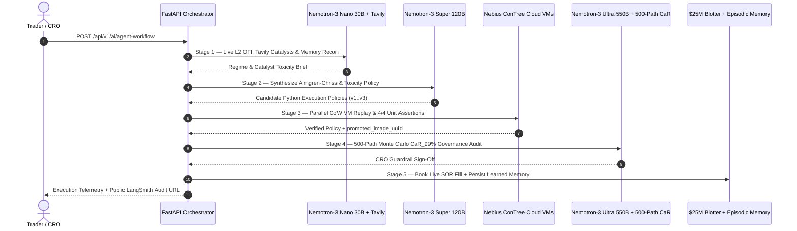

### Dynamic SOR Liquidity Gate State Machine

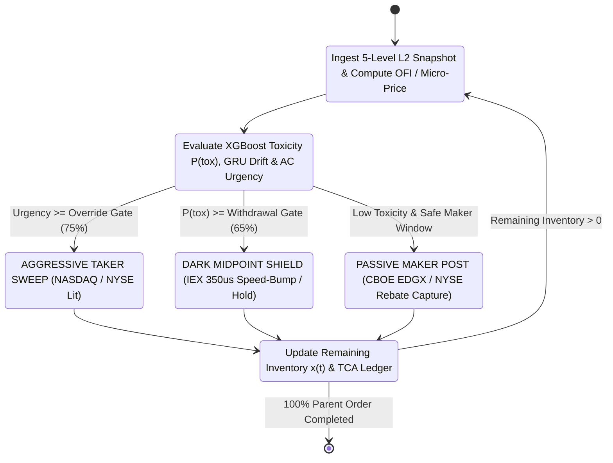

---

## Production Technical Stack

<p align="center">
  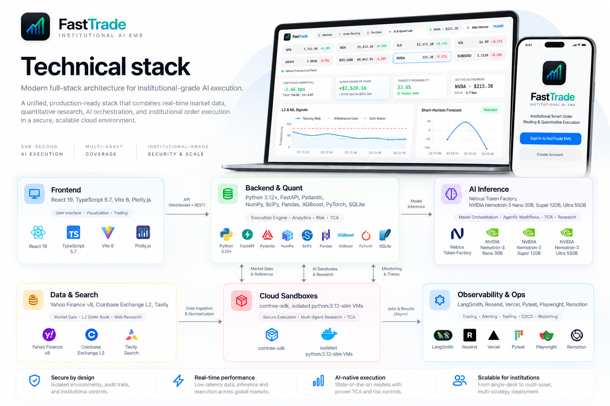
</p>

| Layer | Technologies |
| :--- | :--- |
| **Frontend Terminal** | React 19, TypeScript 5.7, Vite 6, Plotly.js, Responsive Institutional Glassmorphic UI |
| **Backend & Quantitative Core** | Python 3.12+, FastAPI, Pydantic v2, NumPy, SciPy, Pandas, Calibrated XGBoost, PyTorch GRU |
| **AI Model Orchestration** | Nebius Token Factory (`NVIDIA-Nemotron-3-Nano-30B-A3B`, `nemotron-3-super-120b-a12b`, `Nemotron-3-Ultra-550b-a55b`) |
| **Isolated Cloud Sandboxes** | Nebius Sandboxes Beta (`contree-sdk==0.3.6`), Isolated `python:3.12-slim` Micro-VMs with CoW Checkpoints |
| **Market Data & Search** | Yahoo Finance v8 Live API, Coinbase Exchange Level-2 Order Book, Tavily Financial Search & Extract |
| **Persistence, Ops & Governance** | SQLite + Supabase PostgreSQL Mirror, LangSmith Observability, Resend Email Dispatch, Vercel, Pytest, Playwright |

---

## Why FastTrade Stands Out

<p align="center">
  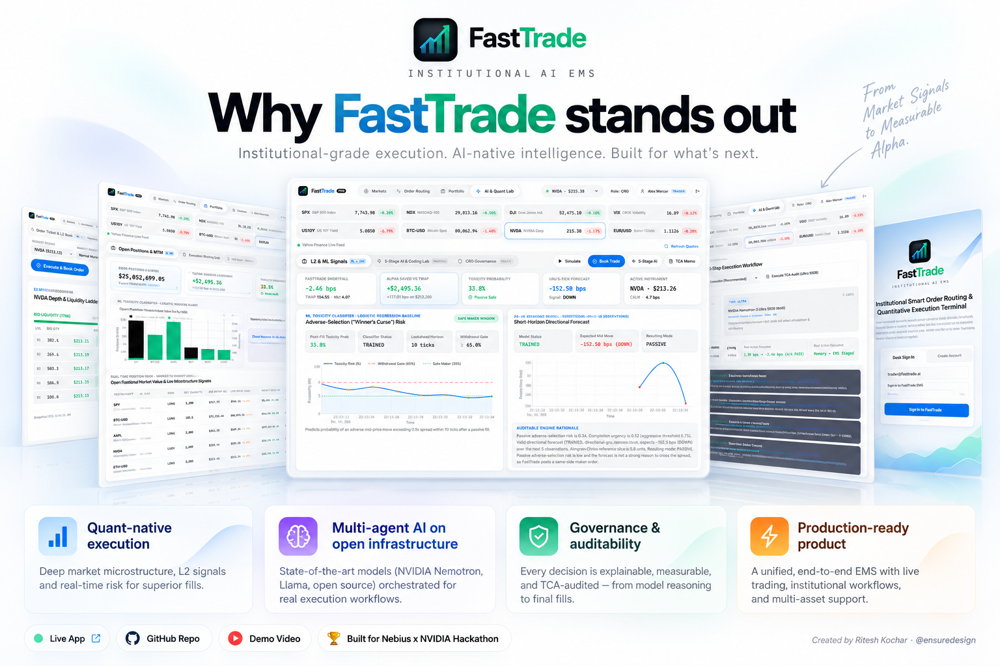
</p>

1. **Quant-Native Execution:** Grounded in Stoikov micro-price, Cont–Kukanov–Stoikov OFI, and closed-form Almgren–Chriss optimal control rather than heuristic prompt engineering.
2. **Multi-Agent AI on Open Infrastructure:** Dynamically routes across three NVIDIA Nemotron-3 MoE tiers on Nebius Token Factory and verifies generated code inside real `contree-sdk` cloud VMs before capital touches the book.
3. **End-to-End Governance & Auditability:** Every slice decision, CRO guardrail check, Monte Carlo tail-risk metric, and multi-model trace is inspectable via 1-click public LangSmith links and exportable TCA memos.
4. **Production-Ready Institutional Product:** Ships with per-user isolated `$25.0M` MTM portfolios, `Trader` / `CRO` RBAC authentication, OWASP hardening, pickle-free serverless ML weights, and automated test coverage.

---

## Technical Documentation Suite (`docs/`)

| Document | Scope & Contents |
| :--- | :--- |
| **[`docs/README.md`](./docs/README.md)** | Visual Documentation Hub & Architecture Reading Map |
| **[`docs/SYSTEM_ARCHITECTURE_AND_FLOWCHARTS.md`](./docs/SYSTEM_ARCHITECTURE_AND_FLOWCHARTS.md)** | 6 Deep Mermaid Diagrams: Full-Stack Architecture, L2 Pipeline, SOR Decision Tree, 5-Stage Agent Sequence, ConTree VM Lifecycle & 8-Table Database ERD |
| **[`docs/QUANTITATIVE_MATHEMATICAL_SPECIFICATION.md`](./docs/QUANTITATIVE_MATHEMATICAL_SPECIFICATION.md)** | Mathematical Whitepaper: Stoikov Micro-Price, CKS OFI, Almgren–Chriss Optimal Control, XGBoost Toxicity, PyTorch GRU, 4-Venue Utility & Monte Carlo CaR |
| **[`docs/AGENTIC_AI_AND_SANDBOX_ARCHITECTURE.md`](./docs/AGENTIC_AI_AND_SANDBOX_ARCHITECTURE.md)** | Nebius Token Factory 3-Tier Router, 5-Stage Autonomous Workflow, Self-Iterating Coding Agent, ConTree VMs, Tavily Search & LangSmith Tracing |
| **[`docs/API_AND_OPERATIONS_GUIDE.md`](./docs/API_AND_OPERATIONS_GUIDE.md)** | Complete 29-Endpoint FastAPI Reference, JSON Payloads, `.env` Configuration, Local Setup & Vercel Deployment Runbook |
| **[`docs/TECHNICAL_ARCHITECTURE_AND_SECURITY_AUDIT.md`](./docs/TECHNICAL_ARCHITECTURE_AND_SECURITY_AUDIT.md)** | OWASP Security Controls, `PBKDF2-HMAC-SHA256` Auth, AST + Cloud VM Isolation, Pickle-Free ML Inference & CRO Guardrails |
| **[`docs/DATA_CONTRACTS.md`](./docs/DATA_CONTRACTS.md)** | Typed Pipeline Schemas (`MarketSnapshot`, `ForecastInput`, `DataQualityReport`) & Canonical `20×14` Feature Contract |
| **[`docs/FORECASTING.md`](./docs/FORECASTING.md)** | PyTorch Directional GRU (`directional-gru-v1`) Training Protocol, Chronological Normalization & Safe Runtime Fallbacks |
| **[`docs/CONTRACT_CHANGE_POLICY.md`](./docs/CONTRACT_CHANGE_POLICY.md)** | Compatibility Gates, Change Classifications & Release Verification Workflow |

---

## Repository Structure

```text
FastTrade/
├── api/                        # FastAPI v2.0 gateway, OWASP middleware & REST routers
│   ├── main.py                 # Unified ASGI app, security headers & SPA static serving
│   └── routes/                 # dashboard.py, ai_copilot.py, auth.py (29 endpoints)
├── data/                       # Typed contracts (20x14), L2 validators, normalizers & generators
├── features/                   # Stoikov micro-price, Cont-Kukanov-Stoikov OFI & rolling features
├── models/                     # Calibrated XGBoost toxicity classifier & PyTorch GRU forecaster
├── execution/                  # Closed-form Almgren-Chriss optimizer & 4-venue liquidity router
├── strategies/                 # FastTrade SOR, Proposed (ML+AC), TWAP, VWAP, Market & Passive
├── simulator/                  # Event-driven L2 limit order book matching & fill simulator
├── backtest/                   # Identical-seed 6-strategy replay backtester & TCA attribution
├── services/                   # Market feeds, $25M portfolio, Nebius AI, ConTree VMs, Tavily, LangSmith, Auth
├── frontend/                   # React 19 + TypeScript 5.7 + Vite 6 + Plotly.js terminal UI
├── public/fasttradeapp/        # Architectural infographics & product showcase visuals
├── docs/                       # Comprehensive engineering, math, API & security specifications
└── tests/                      # Automated unit, contract, forecasting, backtest & API test suite
```

---

## Quick Start

### 1. Clone & Install Dependencies

```bash
git clone https://github.com/ensuredesign/FastTrade.git
cd FastTrade

# Python 3.12+ backend & quantitative engine
pip install -r requirements.txt

# React 19 + TypeScript 5.7 terminal frontend
cd frontend && npm install && cd ..
```

### 2. Configure Environment (Optional — Runs Out-of-the-Box Locally)

```bash
cp .env.example .env
# Optional cloud enhancements in .env:
# NEBIUS_API_KEY=...        (Nebius Token Factory + ConTree Cloud Sandboxes)
# LANGSMITH_API_KEY=...     (LangSmith hierarchical tracing & public share links)
# TAVILY_API_KEY=...        (Live financial news & catalyst search)
# RESEND_API_KEY=...        (Committee HTML TCA email dispatch)
```

### 3. Launch Backend & Frontend

```bash
# Terminal 1 — FastAPI Backend (http://127.0.0.1:8000 | OpenAPI Docs: /docs)
python -m uvicorn api.main:app --host 127.0.0.1 --port 8000 --reload

# Terminal 2 — React + Vite Institutional Terminal (http://127.0.0.1:5173)
cd frontend && npm run dev
```

### 4. Run Automated Test Suite

```bash
python -m pytest -q
```

---

## Governance, Security & Contributing

- **Security Policy:** See [`SECURITY.md`](./SECURITY.md) and [`docs/TECHNICAL_ARCHITECTURE_AND_SECURITY_AUDIT.md`](./docs/TECHNICAL_ARCHITECTURE_AND_SECURITY_AUDIT.md)
- **Contribution Guidelines:** See [`CONTRIBUTING.md`](./CONTRIBUTING.md) and [`docs/CONTRACT_CHANGE_POLICY.md`](./docs/CONTRACT_CHANGE_POLICY.md)
- **Hackathon Submission Overview:** See [`DEVPOST_SUBMISSION.md`](./DEVPOST_SUBMISSION.md)

---

## Author & License

- **Created & Architected by:** Ritesh Kochar ([`@ensuredesign`](https://github.com/ensuredesign) · `ensure01@gmail.com`)
- **Live Terminal:** [https://fasttrade-smoky.vercel.app](https://fasttrade-smoky.vercel.app)
- **2-Minute Product Demo:** [https://youtu.be/I9uMToKesDI](https://youtu.be/I9uMToKesDI)
- **License:** [MIT License](./LICENSE) — Copyright (c) 2026 Ritesh Kochar
