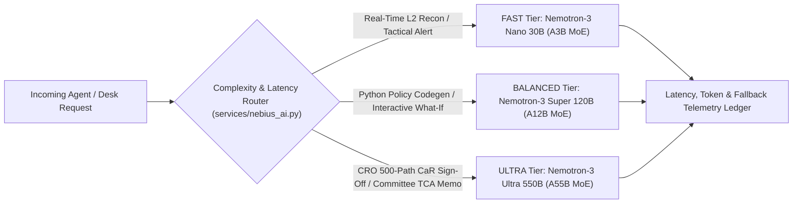
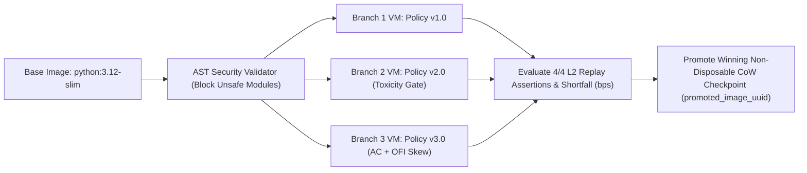

# FastTrade — Multi-Tier Agentic AI, Nebius Cloud Sandboxes & LangSmith Observability

**Author & Lead Architect:** Ritesh Kochar ([`@ensuredesign`](https://github.com/ensuredesign) · `ensure01@gmail.com`)  
**Live Terminal:** [https://fasttrade-smoky.vercel.app](https://fasttrade-smoky.vercel.app) · **2-Min Demo Video:** [https://youtu.be/I9uMToKesDI](https://youtu.be/I9uMToKesDI)

---

## 1. Beyond Single-Prompt Wrappers: Closed-Loop Quantitative Agents

  

Institutional execution desks cannot rely on an ungrounded conversational chatbot to route multi-million-dollar parent orders. **FastTrade** embeds **Nebius Token Factory (`https://api.tokenfactory.nebius.com/v1`)** and **NVIDIA Nemotron-3 Mixture-of-Experts (MoE)** models inside a **closed-loop quantitative engineering harness** backed by isolated micro-VM execution (`contree-sdk`), live financial web intelligence (`Tavily`), persistent episodic memory, and public run-tree auditability (`LangSmith`).

---

## 2. Dynamic 3-Tier NVIDIA Nemotron-3 Model Router (`services/nebius_ai.py`)

FastTrade routes every inference call across three specialized NVIDIA Nemotron-3 MoE tiers based on latency budgets, mathematical depth, and governance criticality (`tier = "auto" | "fast" | "balanced" | "ultra"`):

| Routing Tier | Model Identifier on Nebius Token Factory | Active / Total Params | Target Latency | Institutional Workloads |
| :--- | :--- | :---: | :---: | :--- |
| **FAST (Tier 1)** | `nvidia/NVIDIA-Nemotron-3-Nano-30B-A3B` | `3B / 30B MoE` | Sub-second | Real-time L2 microstructure anomaly alerts, Stage 1 catalyst & memory reconnaissance, tactical desk briefs (`POST /api/v1/ai/tactical-brief`). |
| **BALANCED (Tier 2)** | `nvidia/nemotron-3-super-120b-a12b` | `12B / 120B MoE` | `1.2s – 2.8s` | Interactive quantitative copilot, what-if shock attribution, Almgren–Chriss policy code synthesis, and 3-cycle coding agent refactoring (`POST /api/v1/ai/coding-agent`). |
| **ULTRA (Tier 3)** | `nvidia/Nemotron-3-Ultra-550b-a55b` | `55B / 550B MoE` | `2.5s – 5.0s` | Stage 4 Chief Risk Officer (CRO) 500-path Monte Carlo Cost-at-Risk sign-off and Investment Committee Post-Trade TCA Executive Memos (`POST /api/v1/ai/tca-report`). |

---

## 3. Three Autonomous Agentic Subsystems (`services/agent_workflows.py`)

### 3.1 5-Stage Autonomous Institutional Order Optimization Workflow (`POST /api/v1/ai/agent-workflow`)

Executes an end-to-end multi-agent pipeline from live market reconnaissance to real `$25.0M` blotter execution:

1. **Stage 1 — L2 Microstructure, Tavily Catalyst Search & Episodic Memory Recon (`Nano 30B`):** Pulls live L2 spread/OFI metrics, queries **Tavily Finance Search** for breaking earnings/macro catalysts on the active symbol, and recalls symbol-scoped desk rules from `fasttrade_agent_memories`.
2. **Stage 2 — Almgren–Chriss & Toxicity Policy Synthesis (`Super 120B`):** Synthesizes candidate risk aversion $\lambda$, toxicity withdrawal threshold $\theta_{\text{withdraw}}$, urgency override gate, and child-slice count $N$.
3. **Stage 3 — Nebius Sandboxes Beta 3-Cycle L2 Backtest Loop (`Super 120B` + `contree-sdk`):** Executes `v1 -> v2 -> v3` policy candidates inside isolated `python:3.12-slim` cloud micro-VMs against live-anchored L2 tick streams, verifying `4/4` unit assertions and monotonic Implementation Shortfall convergence.
4. **Stage 4 — CRO 500-Path Monte Carlo Cost-at-Risk Sign-Off (`Ultra 550B`):** Runs a 500-path stochastic jump-diffusion stress test to verify $\text{CaR}_{95\%}$ and $\text{CaR}_{99\%}$ comply with global CRO risk ceilings.
5. **Stage 5 — Autonomous Desk Blotter Fill & Persistent Memory Commit:** Books the calibrated parent order into the live `$25.0M` MTM portfolio (`fasttrade_trades`) and stores the verified regime calibration in `fasttrade_agent_memories`.

### 3.2 Self-Iterating Quant Strategy Coding Agent (`POST /api/v1/ai/coding-agent`)

A test-driven quantitative coding loop (`Write -> AST Check -> Cloud VM Unit Test -> Compiler Diagnosis -> Refactor`):

- **Cycle 1 (`v1.0 Draft — Naive Schedule`):** Generates baseline execution function; unit harness flags toxic passive fills during spread blowouts (`[2/4 PASS]`).
- **Cycle 2 (`v2.0 Refactor — XGBoost Toxicity Shield`):** Injects dynamic maker cancellation when $P(\text{tox}) > \theta_{\text{withdraw}}$ (`[3/4 PASS]`).
- **Cycle 3 (`v3.0 Production — Almgren–Chriss Hyperbolic + CKS OFI Skew`):** Combines hyperbolic inventory urgency with L1 OFI quote skewing, passing all 4 deterministic assertions (`[4/4 PASS]`: *100% Fill Completion*, *Zero Toxic Maker Sweeps*, *Positive Spread Capture*, *Strict Monotonic Shortfall Improvement vs. TWAP*) before 1-click staging to the live EMS.

### 3.3 Context-Persistent Personal Execution Assistant (`POST /api/v1/ai/copilot`)

Maintains durable episodic and semantic memory across sessions (`fasttrade_agent_memories` & `fasttrade_agent_actions`), enabling natural-language operator commands that execute **real state-mutating desk actions**:
- Booking live SOR parent orders directly into the `$25.0M` portfolio blotter
- Persisting new symbol-specific CRO toxicity or slice-sizing mandates
- Calibrating live Almgren–Chriss sliders in the workspace

---

## 4. Nebius Token Factory Sandboxes Beta (`services/nebius_sandbox_service.py`)

FastTrade integrates **`contree-sdk==0.3.6`** to run synthesized quantitative Python strategies and custom operator research scripts inside isolated **Nebius ConTree Cloud Micro-VMs** (`python:3.12-slim`):

- **Defense-in-Depth Isolation:** Code is first validated via Python `ast` static inspection, then executed inside an isolated remote Linux container VM with strict timeout enforcement.
- **Copy-on-Write Checkpointing (`disposable=False`):** Winning strategy environments return an immutable `promoted_image_uuid` for reproducible institutional auditability.
- **Interactive Cloud Runner (`POST /api/v1/ai/sandbox-run`):** Supports dynamic `apt-get` system packages and `pip` scientific packages directly from the **AI & Quant Lab** tab.

---

## 5. Tavily Live Financial Catalyst Intelligence (`services/tavily_service.py`)

Microstructure toxicity spikes frequently originate from exogenous macro releases, SEC filings, or earnings headlines. FastTrade integrates **Tavily Search (`topic="finance"` / `"news"`)** and **Tavily URL Extract** to:
- Retrieve real-time institutional news catalysts for any active ticker (`NVDA`, `BTC-USD`, `SPY`, `AAPL`, `MSFT`, `ETH-USD`, `ES-FUT`, `NQ-FUT`).
- Synthesize catalyst-driven adverse-selection risk via NVIDIA Nemotron-3 and recommend pre-emptive toxicity gate tightening before order book depth evaporates.

---

## 6. LangSmith Hierarchical Tracing & Public Judge Audit Links (`services/langsmith_service.py`)

Every multi-model workflow, coding-agent iteration, Tavily catalyst query, and ConTree Cloud VM execution is instrumented with **LangSmith (`smith.langchain.com`)** under project **`FastTrade-Nebius-EMS`**:

- **Hierarchical Run Trees:** Parent workflow runs nest child spans for Stage 1–5 LLM calls, prompt/completion token counts, latency telemetry, sandbox VM stdout/exit codes, and Monte Carlo $\text{CaR}_{99\%}$ verdicts.
- **1-Click Public Audit Sharing (`POST /api/v1/ai/langsmith-share/{trace_id}`):** Operators, CROs, and hackathon judges can publish read-only `smith.langchain.com/public/.../r` audit URLs directly from the FastTrade UI without needing LangSmith credentials.
- **Verified Live Public Audit Traces:**
  - 5-Stage Autonomous Workflow Trace: [`https://smith.langchain.com/public/92ecc909-fef0-4324-baf3-3a3fcb463a25/r`](https://smith.langchain.com/public/92ecc909-fef0-4324-baf3-3a3fcb463a25/r)
  - Self-Iterating ConTree Sandbox Trace: [`https://smith.langchain.com/public/b12df4b0-9e09-4fa6-9830-c0cfa05dcbdd/r`](https://smith.langchain.com/public/b12df4b0-9e09-4fa6-9830-c0cfa05dcbdd/r)
