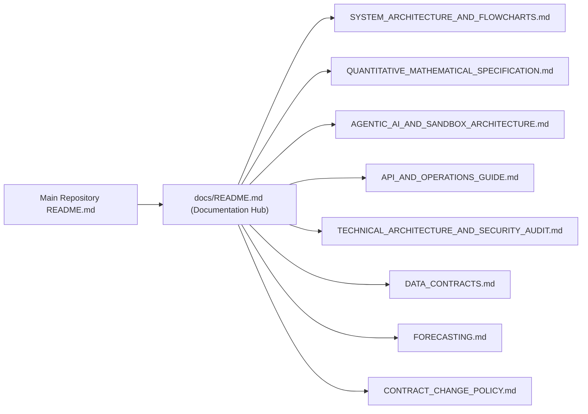

# FastTrade — Technical Documentation Hub

  

  
  
  

Welcome to the engineering, quantitative research, and architectural specification hub for **FastTrade** — an institutional-grade **Smart Order Routing (SOR), Level-2 Market Microstructure, Multi-Tier NVIDIA Nemotron-3 Agentic Execution, and Mark-to-Market Portfolio Terminal**.

---

## Documentation Map

---

## Document Directory

| Document | Audience | Contents |
| :--- | :--- | :--- |
| **[System Architecture & Flowcharts](./SYSTEM_ARCHITECTURE_AND_FLOWCHARTS.md)** | System Architects, Full-Stack Engineers, Hackathon Judges | Layered full-stack architecture, real-time L2 market data pipeline, dynamic SOR decision flowchart, 5-stage agent sequence diagram, ConTree VM sandbox lifecycle, and complete 8-table database ERD. |
| **[Quantitative & Mathematical Specification](./QUANTITATIVE_MATHEMATICAL_SPECIFICATION.md)** | Quant Researchers, Algorithmic Traders, Risk Managers | Stoikov micro-price, Cont–Kukanov–Stoikov OFI, closed-form Almgren–Chriss hyperbolic trajectories, 28-feature calibrated XGBoost toxicity model, PyTorch GRU forecaster, 4-venue utility routing, and 250/500-path Monte Carlo Cost-at-Risk ($\text{CaR}_{95\%/\text{99\%}}$). |
| **[Agentic AI, ConTree Sandboxes & Observability](./AGENTIC_AI_AND_SANDBOX_ARCHITECTURE.md)** | AI/ML Engineers, Platform Architects, Auditors | Complexity-routed NVIDIA Nemotron-3 tiers (`Nano 30B`, `Super 120B`, `Ultra 550B`) on Nebius Token Factory, 5-stage autonomous workflow, self-iterating coding agent in isolated `contree-sdk` VMs, Tavily live financial intelligence, persistent memory, and LangSmith public run-tree traces. |
| **[REST API & Production Operations Guide](./API_AND_OPERATIONS_GUIDE.md)** | Backend/Frontend Developers, DevOps, Integrators | Complete 29-endpoint FastAPI specification, request/response schemas, `.env` configuration reference, local development workflow, Vercel serverless deployment, and automated verification suite. |
| **[Technical Architecture & Security Audit](./TECHNICAL_ARCHITECTURE_AND_SECURITY_AUDIT.md)** | Security Reviewers, Chief Risk Officers (CRO) | OWASP controls, `PBKDF2-HMAC-SHA256` password hashing, stateless HMAC session tokens, AST code validation, micro-VM isolation, HTML sanitization, and CRO risk guardrails. |
| **[Data Contract Reference](./DATA_CONTRACTS.md)** | Core Quant & ML Pipeline Engineers | Authoritative typed schemas (`MarketSnapshot`, `Trade`, `ForecastInput`, `ForecastResult`, `DataQualityReport`) and canonical `20×14` NVIDIA feature ordering. |
| **[Directional Forecasting Specification](./FORECASTING.md)** | ML Engineers | PyTorch GRU (`directional-gru-v1`) training protocol, chronological train-only normalization, runtime ring buffer, and deterministic fallback behavior. |
| **[Data Contract Change Policy](./CONTRACT_CHANGE_POLICY.md)** | Contributors & Maintainers | Change classification rules, forecasting compatibility gates, and mandatory pre-commit test verification checklist. |

---

## Official Links

- **Live Production Terminal:** [https://fasttrade-smoky.vercel.app](https://fasttrade-smoky.vercel.app)
- **Official 2-Minute Product Demo Video:** [https://youtu.be/I9uMToKesDI](https://youtu.be/I9uMToKesDI)
- **GitHub Repository:** [https://github.com/ensuredesign/FastTrade](https://github.com/ensuredesign/FastTrade)
- **Author & Lead Architect:** Ritesh Kochar ([`@ensuredesign`](https://github.com/ensuredesign) · `ensure01@gmail.com`)
