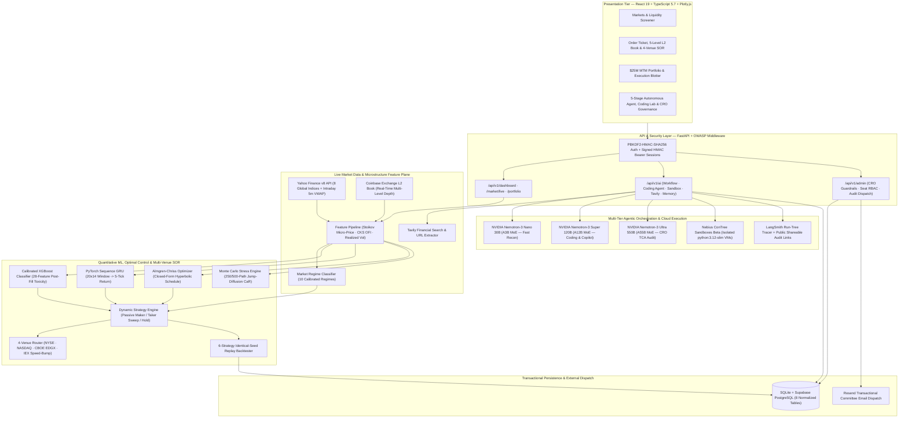
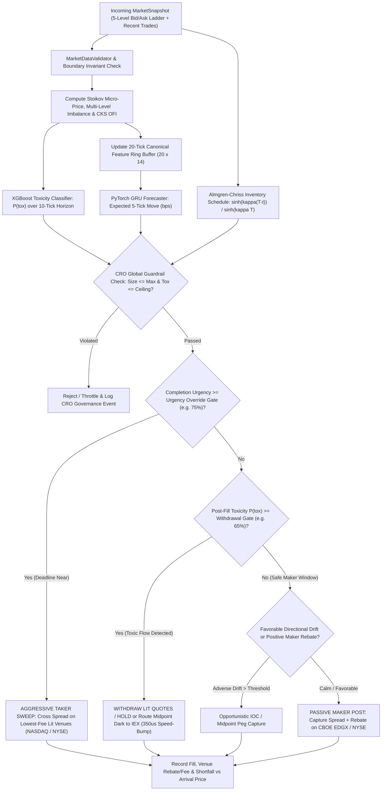
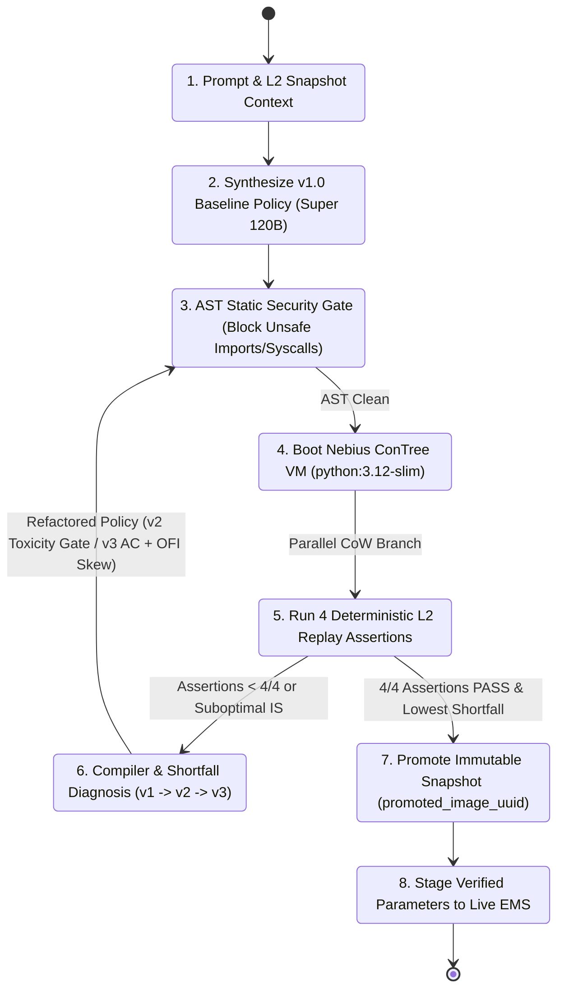
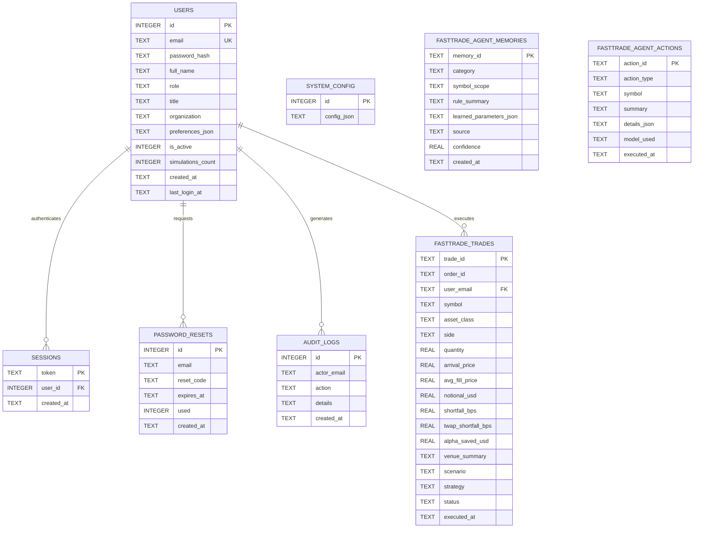

# FastTrade — System Architecture, Dataflow & Engineering Flowcharts

**Author & Lead Architect:** Ritesh Kochar ([`@ensuredesign`](https://github.com/ensuredesign) · `ensure01@gmail.com`)  
**Live Terminal:** [https://fasttrade-smoky.vercel.app](https://fasttrade-smoky.vercel.app) · **2-Min Demo Video:** [https://youtu.be/I9uMToKesDI](https://youtu.be/I9uMToKesDI)

---

## 1. Full-Stack Production Technical Stack

  

FastTrade is architected as a modular, low-latency, full-stack institutional Execution Management System (EMS) divided into six cleanly decoupled operational domains:

| Architectural Plane | Core Technologies & Modules | Primary Responsibility |
| :--- | :--- | :--- |
| **1. Presentation & Interactive Terminal** | React 19, TypeScript 5.7, Vite 6, Plotly.js (`frontend/src/`) | 2-tier institutional navigation (4 primary pillars, 10 contextual workspaces), live L2 depth ladders, tick-by-tick replay scrubber, and interactive risk sliders. |
| **2. API Gateway & Quantitative Core** | Python 3.12+, FastAPI, Pydantic v2, NumPy, SciPy, Pandas, XGBoost, PyTorch (`api/`, `execution/`, `features/`, `models/`) | OWASP-hardened REST API, Stoikov/CKS microstructure extraction, Almgren–Chriss optimal trajectories, 4-venue SOR, and 250/500-path Monte Carlo CaR engine. |
| **3. Multi-Tier AI Inference** | Nebius Token Factory (`api.tokenfactory.nebius.com/v1`), NVIDIA Nemotron-3 `Nano 30B`, `Super 120B`, `Ultra 550B` (`services/nebius_ai.py`) | Complexity-routed tactical briefs, interactive quant copilot, policy code synthesis, and Investment Committee Post-Trade TCA memos. |
| **4. Isolated Cloud Sandboxes** | Nebius Sandboxes Beta (`contree-sdk==0.3.6`), `python:3.12-slim` micro-VMs (`services/nebius_sandbox_service.py`) | Parallel copy-on-write cloud VM branching (`v1 -> v2 -> v3`) for AST-checked Python strategy unit testing and immutable `promoted_image_uuid` promotion. |
| **5. Live Market Data & Catalyst Search** | Yahoo Finance v8 Live API, Coinbase Exchange L2 Book, Tavily Financial Search & Extract (`services/market_data_service.py`, `services/tavily_service.py`) | Concurrent cross-asset intraday quotes, cumulative session VWAP, real-time L2 depth ladders, and live breaking financial news toxicity reconnaissance. |
| **6. Persistence, Governance & Observability** | SQLite + Supabase PostgreSQL Mirror, LangSmith (`smith.langchain.com`), Resend, Vercel, Pytest (`services/auth_service.py`, `services/portfolio_service.py`, `services/langsmith_service.py`) | Per-user `$25.0M` MTM portfolio ledger, RBAC (`Trader` / `CRO`), hierarchical LLM/sandbox run-tree tracing with public audit URLs, and email memo dispatch. |

---

## 2. Layered System Architecture Flowchart

---

## 3. End-to-End 9-Step Institutional Execution Workflow

```mermaid
flowchart LR
    S1["1. Role Sign-In (Trader / CRO)"] --> S2["2. Monitor Live Markets & VWAP"]
    S2 --> S3["3. Screen 8-Asset Liquidity & OFI"]
    S3 --> S4["4. Configure Parent Block Order"]
    S4 --> S5["5. 5-Stage AI & Quant Optimization"]
    S5 --> S6["6. Route Across 4 Venues (NYSE/NASDAQ/EDGX/IEX)"]
    S6 --> S7["7. Inspect 6-Strategy TCA & Toxicity"]
    S7 --> S8["8. Commit Fill to $25M MTM Blotter"]
    S8 --> S9["9. Export Ultra 550B CRO Memo & LangSmith Trace"]
```

  

---

## 4. Real-Time L2 Feature Extraction & Dynamic SOR Decision Tree

Every child-slice decision separates **adverse-selection protection**, **short-horizon directional drift**, and **Almgren–Chriss completion urgency** into deterministic, auditable gates:

---

## 5. 5-Stage Multi-Model Autonomous Agent Sequence Diagram

When an operator triggers `POST /api/v1/ai/agent-workflow`, FastTrade orchestrates all three NVIDIA Nemotron-3 model tiers alongside Tavily live search, isolated Nebius ConTree Cloud VMs, Monte Carlo risk verification, and live blotter execution under a single hierarchical LangSmith trace:

```mermaid
sequenceDiagram
    autonumber
    actor Operator as Institutional Trader / CRO
    participant API as FastAPI Agent Orchestrator
    participant TAV as Tavily Finance Search
    participant MEM as AgentMemoryStore (SQLite)
    participant N30 as Nemotron-3 Nano 30B (Fast)
    participant N120 as Nemotron-3 Super 120B (Balanced)
    participant VM as Nebius ConTree Sandboxes (python:3.12-slim)
    participant MC as 500-Path Monte Carlo CaR Engine
    participant N550 as Nemotron-3 Ultra 550B (Ultra)
    participant PF as $25M Portfolio & Blotter
    participant LS as LangSmith Run-Tree Tracer

    Operator->>API: POST /api/v1/ai/agent-workflow (mission, symbol, auto_commit_trade)
    API->>LS: Open Root Run Trace (FastTrade-Nebius-EMS)

    rect rgb(16, 36, 58)
        Note over API,N30: Stage 1 — Microstructure, Live Catalyst & Episodic Memory Recon
        API->>TAV: Search live financial catalysts (topic="finance")
        API->>MEM: Query symbol-scoped episodic rules & past calibrations
        API->>N30: Synthesize L2 OFI, spread regime, news toxicity & desk mandates
        N30-->>API: Tactical Recon Telemetry
    end

    rect rgb(18, 44, 42)
        Note over API,N120: Stage 2 — Quantitative Policy & Parameter Synthesis
        API->>N120: Synthesize candidate Almgren-Chriss (lambda, N) & toxicity gates
        N120-->>API: Candidate Python Execution Policy + Calibrated Parameters
    end

    rect rgb(38, 30, 58)
        Note over API,VM: Stage 3 — 3-Cycle Self-Iterating Cloud Sandbox Verification
        API->>VM: Execute v1 -> v2 -> v3 policies in isolated ConTree Micro-VMs
        VM-->>API: 4/4 Unit Assertions PASS + Monotonic Shortfall Convergence + promoted_image_uuid
    end

    rect rgb(52, 34, 24)
        Note over API,N550: Stage 4 — 500-Path Monte Carlo CaR Stress & CRO Sign-Off
        API->>MC: Simulate 500 jump-diffusion + Hawkes toxicity paths
        MC-->>API: Expected IS, CaR_95%, CaR_99%, Guardrail Status
        API->>N550: Perform Committee-Grade CRO Risk Audit
        N550-->>API: Signed CRO Approval & Attribution Verdict
    end

    rect rgb(20, 48, 32)
        Note over API,PF: Stage 5 — Autonomous Blotter Fill & Persistent Memory Commit
        API->>PF: Book live-anchored SOR parent order into $25M MTM Blotter
        API->>MEM: Persist learned parameter calibration & action audit record
    end

    API->>LS: Finalize Root Trace & Generate Shareable Public Audit Link
    API-->>Operator: 5-Stage Result + Blotter Fill + LangSmith Trace ID
```

---

## 6. Self-Iterating Quant Coding Agent & Nebius ConTree Sandbox Lifecycle

---

## 7. Normalized Database Entity-Relationship Diagram (ERD)

FastTrade persists institutional accounts, cryptographic sessions, audit trails, `$25.0M` portfolio fills (mirrored asynchronously to Supabase PostgreSQL when configured), and persistent agent memories across **8 normalized tables**:

