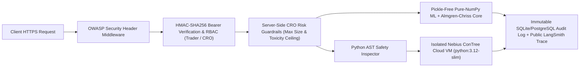

# FastTrade — Institutional Technical Architecture & Security Audit Report (v2.0)

**Author & Lead Architect:** Ritesh Kochar ([`@ensuredesign`](https://github.com/ensuredesign) · `ensure01@gmail.com`)  
**Platform:** FastTrade Institutional Execution Management System (EMS) & Multi-Agent Quant Terminal  
**Live Production URL:** [https://fasttrade-smoky.vercel.app](https://fasttrade-smoky.vercel.app)  
**Official 2-Minute Demo Video:** [https://youtu.be/I9uMToKesDI](https://youtu.be/I9uMToKesDI)  
**Repository:** [https://github.com/ensuredesign/FastTrade](https://github.com/ensuredesign/FastTrade)

---

## 1. Executive Summary

**FastTrade** is a full-stack institutional **Smart Order Routing (SOR), Live Market Microstructure, Mark-to-Market Portfolio & Trade Blotter, and Multi-Agent Quantitative Execution Terminal** engineered by **Ritesh Kochar**.

It bridges closed-form order-book microstructure mathematics with live cross-asset market data, isolated cloud micro-VM strategy verification, persistent multi-asset portfolio accounting, and multi-tier NVIDIA Nemotron-3 reasoning:

1. **Live Cross-Asset Market Feed (`services/market_data_service.py`):**
   - Concurrent live fetching from **Yahoo Finance v8** (`interval=5m&range=1d`) and **Coinbase Exchange L2 Book** (`products/{id}/book?level=2`).
   - Streams live quotes, 24h changes, session high/low ranges, annualized realized volatility ($\sigma$), signed Order Flow Imbalance ($\text{OFI}$), and 5-minute intraday price & cumulative session VWAP curves across 8 global benchmarks (`SPX`, `NDX`, `DJI`, `VIX`, `US10Y`, `BTC-USD`, `NVDA`, `EUR/USD`) and 8 tradable institutional instruments (`NVDA`, `BTC-USD`, `SPY`, `AAPL`, `MSFT`, `ETH-USD`, `ES-FUT`, `NQ-FUT`).
2. **Real-Time Mark-to-Market Portfolio & Execution Trade Blotter (`services/portfolio_service.py`):**
   - Manages per-user isolated `\$25,000,000` institutional multi-asset position books with average-cost realized & unrealized P&L attribution, gross/net exposure tracking, cumulative implementation shortfall savings vs. TWAP (`\$ USD`), and a CSV-exportable immutable execution blotter mirrored asynchronously to Supabase PostgreSQL.
3. **Closed-Form Almgren–Chriss & Pre-Trade Monte Carlo Cost-at-Risk (`execution/almgren_chriss.py`, `api/routes/dashboard.py`):**
   - Computes optimal hyperbolic execution trajectories $x(t_j) = X_0 \sinh(\kappa(T-t_j))/\sinh(\kappa T)$ and simulates 250–500 stochastic jump-diffusion + Hawkes toxicity paths to quantify Expected Implementation Shortfall, $\text{CaR}_{95\%}$, $\text{CaR}_{99\%}$, and 1-click closed-form parameter calibration.
4. **4-Venue Fragmented Liquidity Router & 6-Strategy Identical-Replay Backtester (`execution/venue_router.py`, `backtest/backtester.py`):**
   - Allocates child slices dynamically across `NYSE`, `NASDAQ`, `CBOE EDGX`, and `IEX` (350µs dark midpoint speed-bump protection) and benchmarks `FastTrade (ML + NVIDIA + AC)` against `Market`, `TWAP`, `VWAP`, `Almgren-Chriss`, and `Proposed (ML + AC)` on identical tick streams.
5. **Multi-Tier NVIDIA Nemotron-3 Agents, ConTree Cloud Sandboxes & LangSmith Observability (`services/nebius_ai.py`, `services/nebius_sandbox_service.py`, `services/langsmith_service.py`):**
   - Complexity-routed inference across **Nemotron-3 Nano 30B**, **Super 120B**, and **Ultra 550B** on **Nebius Token Factory**, backed by isolated **`contree-sdk` (`python:3.12-slim`) Cloud VMs**, live **Tavily** financial search, persistent episodic memory, and public **LangSmith** run-tree audit links.

---

## 2. Application Security, Sandboxing & OWASP Audit Summary

| Security Control | Implementation in FastTrade | Verification Status |
| :--- | :--- | :---: |
| **Cryptographic Password Hashing** | `PBKDF2-HMAC-SHA256` with `100,000` iterations, 16-byte per-user CSPRNG salt (`secrets.token_hex(16)`), and constant-time digest verification (`secrets.compare_digest`). | **VERIFIED** (`services/auth_service.py`) |
| **Stateless HMAC Session Tokens** | Signed `HMAC-SHA256` bearer tokens with strict expiration validation (`exp` claim) and role-based access enforcement (`Trader` vs. `CRO`). | **VERIFIED** (`services/auth_service.py`) |
| **AST Static Code Analysis + Cloud Micro-VM Isolation** | Synthesized quant strategies pass Python `ast` static validation (blocking unauthorized filesystem/network/process primitives) and execute inside isolated remote **Nebius ConTree Linux Micro-VMs (`python:3.12-slim`)** rather than the host API process. | **VERIFIED** (`services/agent_workflows.py`, `services/nebius_sandbox_service.py`) |
| **OWASP HTTP Security Headers** | Global ASGI middleware injecting `X-Content-Type-Options: nosniff`, `X-Frame-Options: DENY`, `Referrer-Policy: strict-origin-when-cross-origin`, `X-XSS-Protection: 1; mode=block`, `Permissions-Policy`, and `Cache-Control: no-store` on `/api/*`. | **VERIFIED** (`api/main.py`) |
| **SPA Static Path Traversal Guard** | Resolved candidate paths are strictly verified to reside within `FRONTEND_DIST.resolve()` prior to `FileResponse` serving. | **VERIFIED** (`api/main.py`) |
| **HTML Injection / XSS Sanitization** | `html.escape(..., quote=True)` applied to all dynamic operator and trade fields prior to HTML committee email dispatch via Resend. | **VERIFIED** (`services/email_service.py`) |
| **CRO Risk Guardrail Enforcement** | Server-side enforcement of `max_parent_order_size` and `global_toxicity_ceiling` across simulation, autonomous workflow, and pre-trade Monte Carlo endpoints. | **VERIFIED** (`api/routes/dashboard.py`) |
| **Pickle-Free Pure-NumPy ML Weights** | Exported pure-NumPy weight artifacts (`adverse_selection_numpy.npz` & `directional_forecaster_numpy.npz`) eliminating insecure `pickle` deserialization and cold-start overhead on serverless deployments. | **VERIFIED** (`models/predictor.py`, `models/local_forecaster.py`) |
| **Immutable Public Auditability** | Every autonomous agent run and sandbox verification produces an immutable `audit_logs` record and optional read-only public **LangSmith** trace link (`smith.langchain.com/public/.../r`). | **VERIFIED** (`services/langsmith_service.py`) |

---

## 3. Security Architecture Flowchart

---

## 4. Cross-References

- Full system diagrams & 8-table database ERD: [`docs/SYSTEM_ARCHITECTURE_AND_FLOWCHARTS.md`](./SYSTEM_ARCHITECTURE_AND_FLOWCHARTS.md)
- Mathematical derivations & venue economics: [`docs/QUANTITATIVE_MATHEMATICAL_SPECIFICATION.md`](./QUANTITATIVE_MATHEMATICAL_SPECIFICATION.md)
- Multi-tier agent, sandbox & observability spec: [`docs/AGENTIC_AI_AND_SANDBOX_ARCHITECTURE.md`](./AGENTIC_AI_AND_SANDBOX_ARCHITECTURE.md)
- Complete 29-endpoint REST API & deployment guide: [`docs/API_AND_OPERATIONS_GUIDE.md`](./API_AND_OPERATIONS_GUIDE.md)
